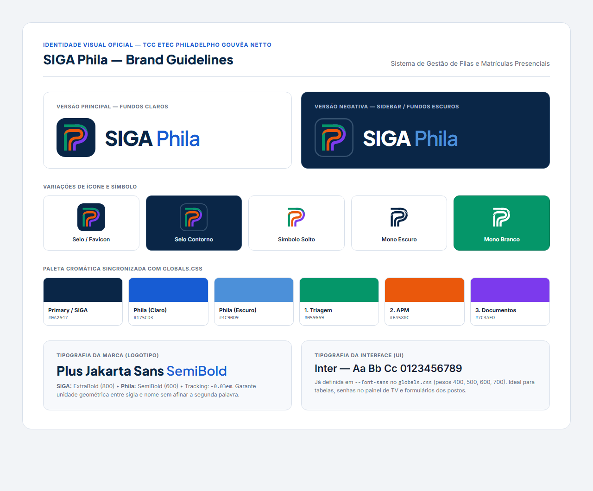

# Identidade Visual Oficial — SIGA Phila

Este documento define o guia completo da identidade visual do **SIGA Phila** (*Sistema de Gestão de Filas e Matrículas Presenciais*), desenvolvido para a **Etec Philadelpho Gouvêa Netto** (Centro Paula Souza), reunindo logotipo, ícone, tipografia, paleta de cores, regras de uso e mapa de aplicação no sistema.



---

## 1. Conceito e Nome da Marca

- **Nome Oficial:** `SIGA Phila`
- **Subtítulo / Descrição Institucional:** `Sistema de Gestão de Filas e Matrículas Presenciais`
- **Grafia Obrigatória:**
  - Sempre escrever **`SIGA`** em caixa alta e **`Phila`** em *Title Case* (nunca `Siga phila`, `SIGA PHILA` em texto corrido ou apenas `SP`).
- **Significado do Símbolo ("P" em 3 Fluxos):**
  - O ícone une o monograma **"P"** (de *Philadelpho / Phila*) com **três trilhas paralelas contínuas** que representam uma fila organizada avançando em sincronia pelos três postos presenciais do sistema:
    1. **Verde Esmeralda (`#059669`)** — Posto 1: **Triagem**
    2. **Laranja (`#ea580c`)** — Posto 2: **APM**
    3. **Roxo (`#7c3aed`)** — Posto 3: **Documentos**
  - As três trilhas partem alinhadas da base e convergem na curva superior do **"P"**, simbolizando o caminho do candidato desde a retirada da senha até a conclusão da matrícula.

---

## 2. Kit de Arquivos Oficiais (`assets/`)

Todos os arquivos vetoriais e de referência estão centralizados em [`documentação/identidadeVisual/assets/`](./assets/):

| Arquivo | Tipo | Quando Usar |
| :--- | :--- | :--- |
| [`logo-siga-phila-clara.svg`](./assets/logo-siga-phila-clara.svg) | Logo Horizontal (Fundo Claro) | Tela de login (`LoginPage`), documentos, relatórios e slides do TCC em fundo branco/cinza claro. |
| [`logo-siga-phila-escura.svg`](./assets/logo-siga-phila-escura.svg) | Logo Horizontal (Fundo Escuro) | Barra lateral administrativa (`AdminSideBar` expandida) e cabeçalhos em `#0a2647`. |
| [`icone-siga-phila.svg`](./assets/icone-siga-phila.svg) | Selo / App Icon | `favicon.svg` do navegador, ícone PWA e avatares do sistema sobre fundo claro. |
| [`icone-siga-phila-contorno.svg`](./assets/icone-siga-phila-contorno.svg) | Selo com Borda Sutil (`#35516f`) | `AdminSideBar` recolhida (`w-20`) ou cards escuros em `#0a2647`, garantindo separação visual da borda. |
| [`icone-siga-phila-simbolo.svg`](./assets/icone-siga-phila-simbolo.svg) | Símbolo "P" Sem Selo | Uso minimalista direto sobre fundo `#ffffff` ou `#0a2647` quando não se deseja o quadrado arredondado. |
| [`icone-siga-phila-mono-escuro.svg`](./assets/icone-siga-phila-mono-escuro.svg) | Monocromático Escuro (`#0a2647`) | Comprovantes térmicos (ESC/POS / impressão P&B), carimbos e marcas d'água em papel claro. |
| [`icone-siga-phila-mono-branco.svg`](./assets/icone-siga-phila-mono-branco.svg) | Monocromático Branco (`#ffffff`) | Aplicação direta sobre fundos coloridos dos postos (verde Triagem, laranja APM ou roxo Docs). |
| [`prancha-identidade-visual.png`](./assets/prancha-identidade-visual.png) | Prancha Resumo (PNG) | Referência rápida para documentação escrita, banner ou apresentação da banca do TCC. |
| [`referencia-aprovada.png`](./assets/referencia-aprovada.png) | Conceito Original Aprovado | Referência visual base aprovada antes da vetorização geométrica. |

---

## 3. Paleta de Cores Oficial

A paleta da marca é **100% sincronizada com os tokens CSS** já definidos em [`frontend/src/globals.css`](../../frontend/src/globals.css).

### 3.1 Cores Principais da Marca

| Papel | Nome | Hex | Token em `globals.css` | Uso Principal |
| :--- | :--- | :--- | :--- | :--- |
| **Primária / Selo** | Azul Marinho ETEC | `#0a2647` | `--color-primary` / `--color-admin-sidebar` | Fundo do selo, texto `"SIGA"` em fundo claro e versão mono escura. |
| **Secundária (Claro)** | Azul Institucional | `#175cd3` | `--color-status-info` | Texto `"Phila"` na versão sobre fundo claro (melhor contraste que azul claro). |
| **Secundária (Escuro)** | Azul Destaque | `#4c90d9` | `--color-focus-ring` | Texto `"Phila"` na versão negativa sobre `#0a2647` (ex.: `AdminSideBar`). |
| **Contorno em Fundo Escuro** | Azul Ardósia | `#35516f` | `--color-admin-sidebar-divider` | Borda de `4px` (no `viewBox 128`) do selo quando aplicado sobre `#0a2647`. |
| **Fundo Claro** | Branco Puro | `#ffffff` | `--color-surface` | Texto `"SIGA"` na versão escura, fundo dos cards e versão mono branca. |
| **Fundo de Página** | Cinza Neve | `#f2f4f7` | `--color-page` | Superfície padrão das páginas públicas e operacionais. |

### 3.2 Cores dos Postos (Trilhas do Ícone "P")

| Trilha no Ícone | Posto Operacional | Hex | Token em `globals.css` |
| :--- | :--- | :--- | :--- |
| **Trilha 1 (Topo / Externa Esquerda)** | **Triagem** | `#059669` | `--color-triagem` |
| **Trilha 2 (Laço Central)** | **APM** | `#ea580c` | `--color-apm` |
| **Trilha 3 (Curva Externa Direita)** | **Documentos** | `#7c3aed` | `--color-docs` |

> **Regra de convivência institucional:** Nas telas onde a logo oficial da escola ([`logoEtec.png`](../../frontend/src/assets/logoEtec.png)) estiver visível (Totem e Painel de TV), a marca **SIGA Phila** não utiliza tons de vermelho para não competir visualmente com a cor institucional do Centro Paula Souza.

---

## 4. Tipografia Oficial

### 4.1 Tipografia do Logotipo (`SIGA Phila`)
Para corrigir o contraste fraco entre `"SIGA"` e `"Phila"` e manter geometria moderna e uniforme, a família oficial do wordmark é **Plus Jakarta Sans**:

| Palavra | Fonte | Peso (`font-weight`) | Tracking (`letter-spacing`) | Cor (Fundo Claro) | Cor (Fundo Escuro) |
| :--- | :--- | :--- | :--- | :--- | :--- |
| **`SIGA`** | `Plus Jakarta Sans` | `800` (ExtraBold) | `-0.03em` | `#0a2647` | `#ffffff` |
| **`Phila`** | `Plus Jakarta Sans` | `600` (SemiBold) | `-0.03em` | `#175cd3` | `#4c90d9` |

*(Fallback aceito sem nova fonte: `Inter` com peso `800` em `SIGA` e `600` em `Phila`.)*

### 4.2 Tipografia da Interface (UI)
- **Família Principal:** `Inter` (`"Inter", "Roboto", sans-serif`), conforme token `--font-sans` em [`frontend/src/globals.css`](../../frontend/src/globals.css).
- **Pesos utilizados na UI:** `400` (Regular para textos), `500` (Medium para labels/menus), `600` (SemiBold para subtítulos e botões), `700` (Bold para títulos e senhas em destaque).

### 4.3 Alerta Técnico para Aplicação no Projeto
No estado atual do repositório, [`frontend/src/globals.css`](../../frontend/src/globals.css) declara `--font-sans: "Inter", "Roboto", sans-serif;`, mas o [`frontend/index.html`](../../frontend/index.html) ainda não importa nenhuma webfont externa (fazendo o navegador usar fallback do sistema operacional). Ao aplicar a identidade visual, adicione as fontes no `<head>` de `frontend/index.html`:

```html
<link rel="preconnect" href="https://fonts.googleapis.com" />
<link rel="preconnect" href="https://fonts.gstatic.com" crossorigin />
<link
  href="https://fonts.googleapis.com/css2?family=Inter:wght@400;500;600;700&family=Plus+Jakarta+Sans:wght@600;700;800&display=swap"
  rel="stylesheet"
/>
```

*(Caso o sistema rode em rede escolar totalmente offline no dia da matrícula, recomenda-se instalar `@fontsource/inter` e `@fontsource/plus-jakarta-sans` no `frontend` em vez de depender de CDN.)*

---

## 5. Regras de Construção, Tamanhos e Restrições

### 5.1 Área de Respiro (Clear Space) e Proporções
- **Grid base do ícone:** `128 × 128 px` | Raio do selo: `28 px` (`~22%` do lado) | Espessura base das fitas: `~9,3 px` | Canal entre hastes: `5,5 px` (com dobras sobrepostas em curva contínua nas transições superiores).
- **Área de respiro mínima:** Manter ao redor da logo ou do ícone uma margem livre equivalente a pelo menos **25% da altura do ícone** (equivalente a `32 px` na escala `128 px`, ou ~`8 px` em um ícone de `32 px`).
- **Relação ícone + texto no lockup horizontal:** Espaço entre o selo e `"SIGA"` equivalente a ~`20%` da largura do selo (`26 px` na escala `128 px`); altura óptica do texto em torno de `42%` a `46%` da altura do selo.

### 5.2 Tamanhos Mínimos
- **Favicon / Aba do navegador:** `16 × 16 px` e `32 × 32 px` (usar exclusivamente [`icone-siga-phila.svg`](./assets/icone-siga-phila.svg), **nunca** a logo com texto).
- **Ícone isolado na UI (sidebar recolhida):** mínimo `36 × 36 px` (`h-9 w-9`).
- **Logo horizontal completa:** largura mínima de `130 px` em telas digitais para manter `"Phila"` legível.

### 5.3 O Que Não Fazer
- Não distorcer, esticar ou inclinar a proporção `1:1` do selo.
- Não alterar a ordem das cores das trilhas (**Verde → Laranja → Roxo**).
- Não aplicar sombras pesadas, brilhos 3D ou gradientes sobre o vetor flat.
- Não usar a versão clara (`logo-siga-phila-clara.svg`) sobre o fundo escuro da sidebar sem contraste no texto `"SIGA"`.
- Não usar versão colorida em impressora térmica monocromática (sempre usar `icone-siga-phila-mono-escuro.svg` ou texto simples).

---

## 6. Mapa de Aplicação no Sistema (Checklist Técnico)

| Local no Código | Elemento a Aplicar | Observação de Implementação |
| :--- | :--- | :--- |
| [`frontend/public/favicon.svg`](../../frontend/public/favicon.svg) e [`frontend/index.html`](../../frontend/index.html) | Substituir o `favicon.svg` padrão do Vite por `icone-siga-phila.svg` e adicionar `<link rel="icon" type="image/svg+xml" href="/favicon.svg" />`. | Também atualizar `<html lang="pt-BR">` e incluir as fontes (`Inter` e `Plus Jakarta Sans`). |
| [`frontend/src/pages/LoginPage.jsx`](../../frontend/src/pages/LoginPage.jsx) | Inserir a logo horizontal clara centralizada acima do título `"Entrar no sistema"`. | Reduzir destaque do `<h1>` ou usá-lo como subtítulo de apoio para não poluir o card `max-w-md`. |
| [`frontend/src/features/admin/layout/adminSideBar.jsx`](../../frontend/src/features/admin/layout/adminSideBar.jsx) | Quando `collapsed === false` (`w-72`), exibir a logo horizontal escura (`SIGA` branco + `Phila` `#4c90d9`) acima de `"Administração"`. Quando `collapsed === true` (`w-20`), exibir o `icone-siga-phila-contorno`. | Mantém a identidade contínua ao expandir/recolher a sidebar. |
| [`frontend/src/pages/EmitirSenhaPage.jsx`](../../frontend/src/pages/EmitirSenhaPage.jsx) e [`frontend/src/pages/PainelPage.jsx`](../../frontend/src/pages/PainelPage.jsx) | Manter [`logoEtec.png`](../../frontend/src/assets/logoEtec.png) como protagonista institucional e posicionar o selo + `"SIGA Phila"` em tamanho discreto no rodapé (ex.: *"Powered by SIGA Phila"*). | Evita poluição visual no Totem e na TV da sala de espera. |
| [`frontend/src/features/postos/layout/Header.jsx`](../../frontend/src/features/postos/layout/Header.jsx) e [`SecretariaPage.jsx`](../../frontend/src/features/secretaria/pages/SecretariaPage.jsx) | Opcional: exibir o ícone discreto (`icone-siga-phila-contorno.svg` ou `simbolo`) ao lado do nome do posto/atendente no topo escuro. | Mantém o foco operacional no nome do posto e número do guichê. |
| Impressão Térmica ([`IMPRESSORA.md`](../IMPRESSORA.md)) | Utilizar `icone-siga-phila-mono-escuro.svg` (ou versão raster P&B `1-bit` derivada dela) no cabeçalho do cupom caso o layout use `@media print`. | Em ESC/POS puro via hardware sem suporte gráfico, manter cabeçalho textual `"SIGA PHILA - ETEC"`. |

---

## 7. Sugestão de Componente React (Referência DRY)

Como a logo aparecerá em **3 ou mais pontos** do sistema (`LoginPage`, `AdminSideBar`, `EmitirSenhaPage` / `PainelPage`), faz sentido criar um único componente reutilizável em `frontend/src/components/ui/LogoSigaPhila.jsx` seguindo o padrão KISS do projeto — mantendo apenas o ícone em SVG inline (para trocar borda/cor com nitidez) e a tipografia com classes Tailwind reais:

```jsx
const LogoSigaPhila = ({
  tema = "claro",
  somenteIcone = false,
  tamanho = "md",
}) => {
  const escuro = tema === "escuro";
  const tamanhos = {
    sm: { icone: "h-8 w-8", texto: "text-lg" },
    md: { icone: "h-10 w-10", texto: "text-2xl" },
    lg: { icone: "h-12 w-12", texto: "text-3xl" },
  };
  const escala = tamanhos[tamanho] ?? tamanhos.md;

  return (
    <div className="inline-flex items-center gap-3 select-none">
      <svg
        xmlns="http://www.w3.org/2000/svg"
        viewBox="0 0 128 128"
        fill="none"
        aria-hidden="true"
        className={`${escala.icone} shrink-0`}
      >
        <rect
          x={escuro ? 2 : 0}
          y={escuro ? 2 : 0}
          width={escuro ? 124 : 128}
          height={escuro ? 124 : 128}
          rx={escuro ? 26 : 28}
          fill="#0a2647"
          stroke={escuro ? "#35516f" : "none"}
          strokeWidth={escuro ? 4 : 0}
        />
        <path fill="#7c3aed" d="M 54.1 106.5 V 89.5 C 54.1 81 59.5 76.2 68.5 75.2 C 83.5 73.5 93.2 63.5 93.2 50.8 C 93.2 38.2 83.5 29.5 68.5 29.5 H 60 V 20.7 H 70.5 C 89.8 20.7 102.6 33.4 102.6 51.2 C 102.6 69.5 89 82.8 71 84.5 C 65.4 85 63.4 87.6 63.4 92.5 V 106.5 Z" />
        <path fill="#059669" d="M 24.5 106.5 V 57.5 C 24.5 44.5 32.5 37 45.5 37 H 47 V 45.4 H 45.5 C 37.8 45.4 33.8 50 33.8 58 V 106.5 Z" />
        <path fill="#ea580c" d="M 39.3 106.5 V 86.5 C 39.3 70.5 49.5 60.5 65.5 60.5 H 70.5 C 75.6 60.5 78.6 57.5 78.6 53 C 78.6 48.5 75.6 45.6 70.5 45.6 H 46.5 C 35.2 45.6 26.5 50.6 24.5 58.2 C 25.2 44 34.5 36.2 48 36.2 H 70.5 C 81.2 36.2 87.8 43 87.8 53 C 87.8 63 81.2 69.8 70.5 69.8 H 65.5 C 54.6 69.8 48.6 75.6 48.6 86.5 V 106.5 Z" />
        <path fill="#059669" d="M 24.5 20.7 H 70.5 C 89.8 20.7 102.6 33.4 102.6 51.2 C 100.8 38.8 88.8 29.5 70.5 29.5 H 24.5 Z" />
      </svg>

      {!somenteIcone && (
        <span
          className={`${escala.texto} leading-none tracking-[-0.03em] font-['Plus_Jakarta_Sans','Inter',sans-serif]`}
        >
          <span className={`font-extrabold ${escuro ? "text-text-inverse" : "text-primary"}`}>
            SIGA
          </span>{" "}
          <span className={`font-semibold ${escuro ? "text-focus-ring" : "text-status-info"}`}>
            Phila
          </span>
        </span>
      )}
    </div>
  );
};

export default LogoSigaPhila;
```
